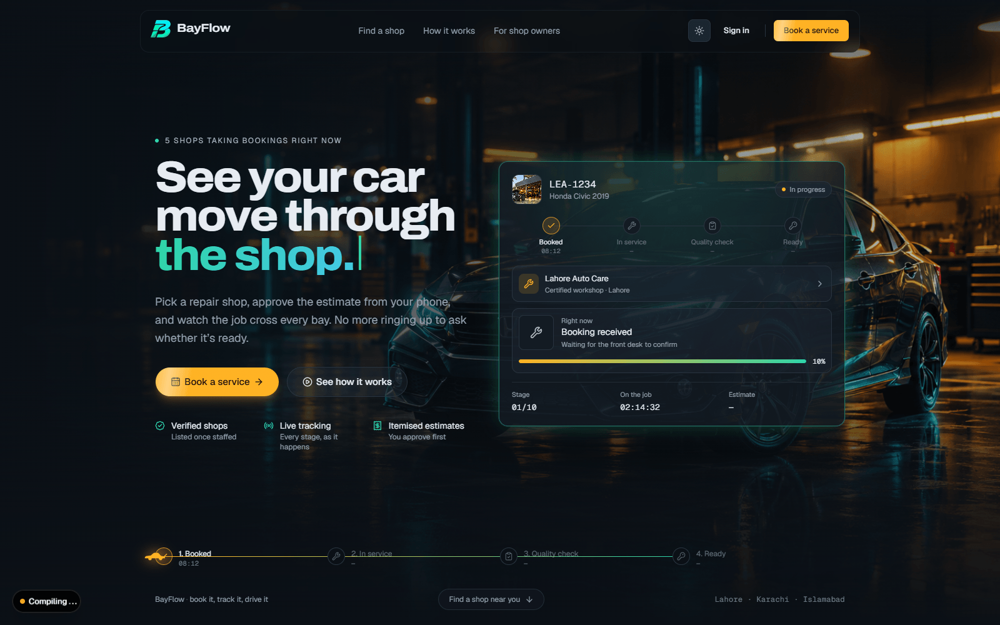
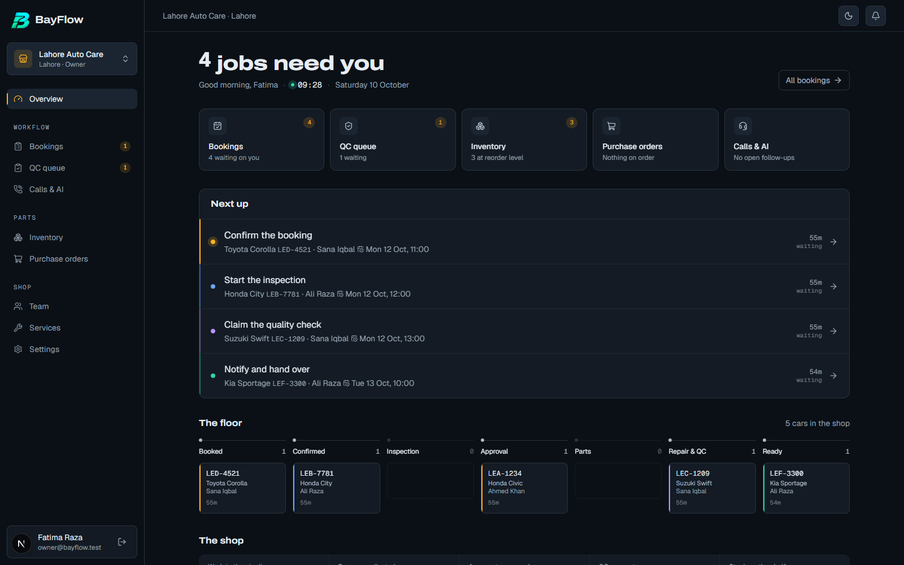
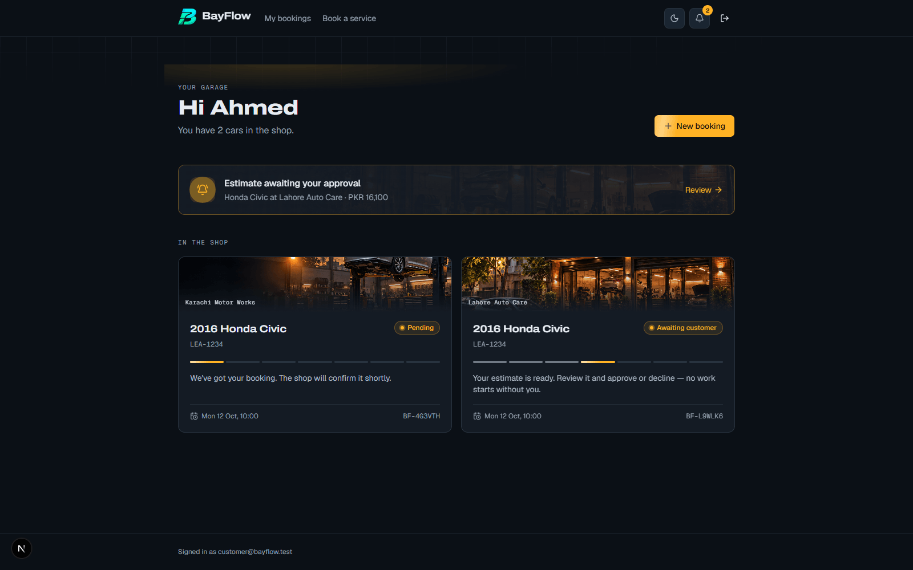
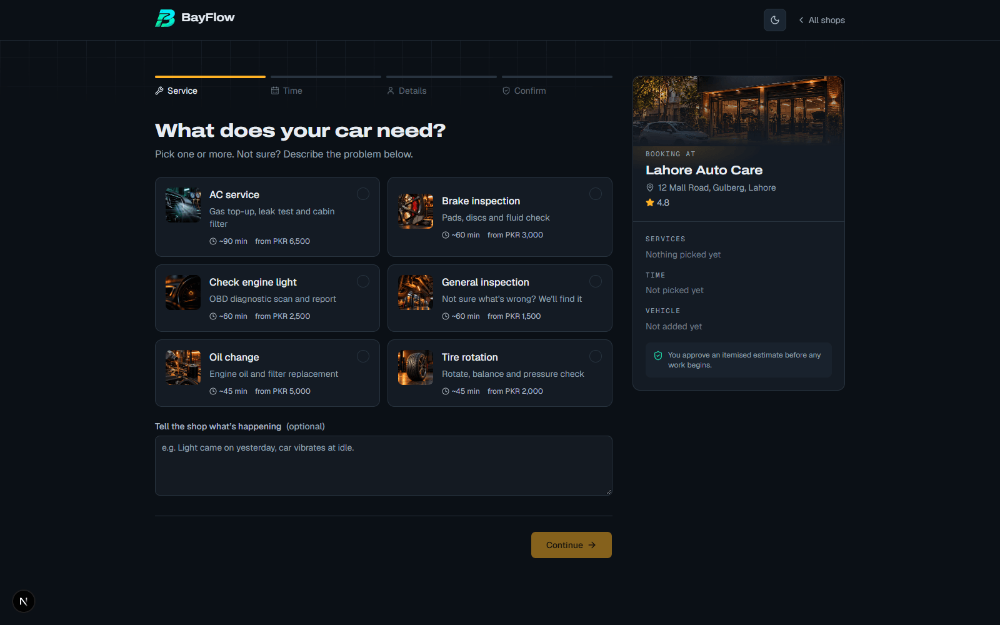
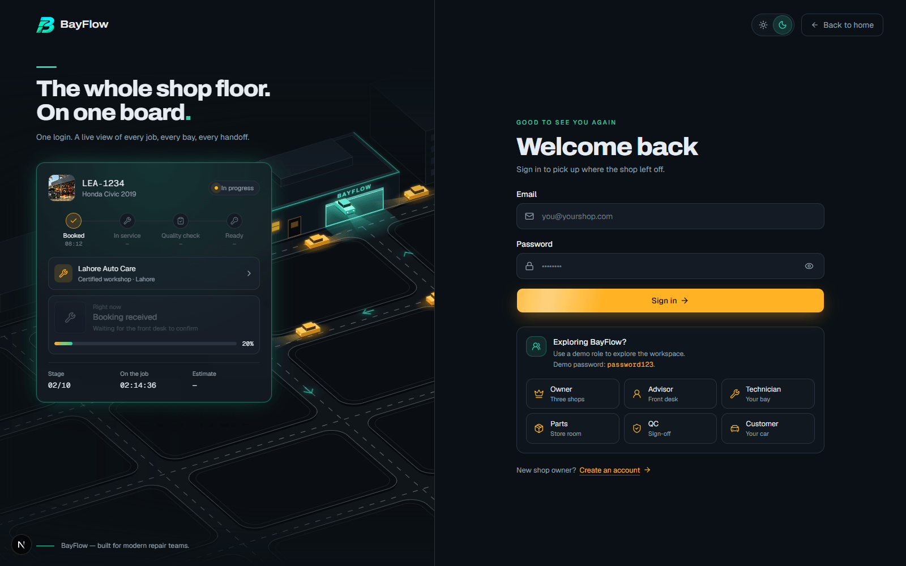
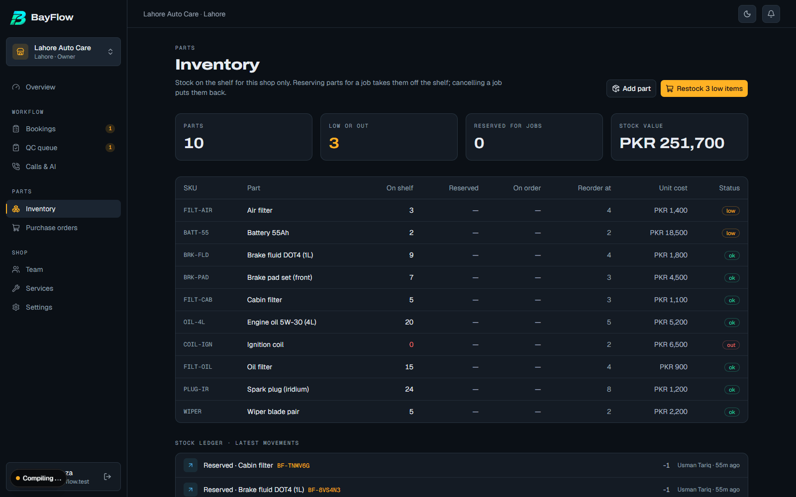
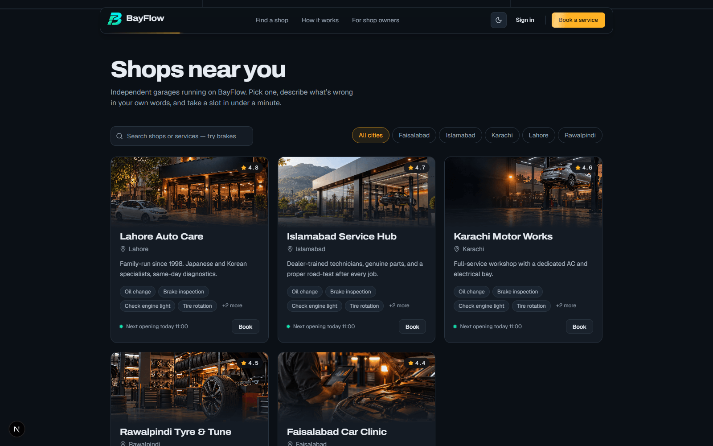
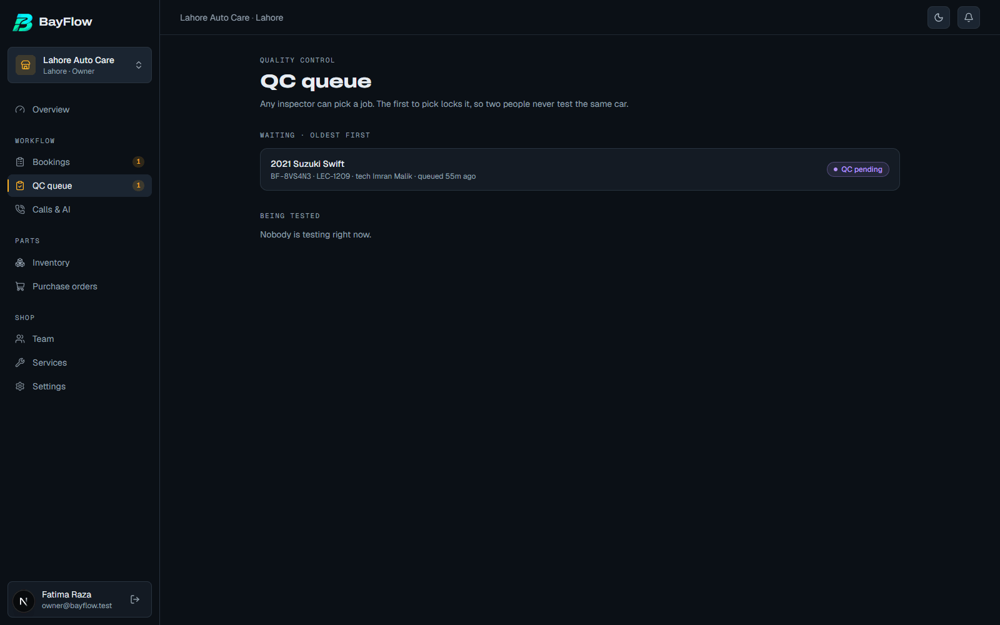
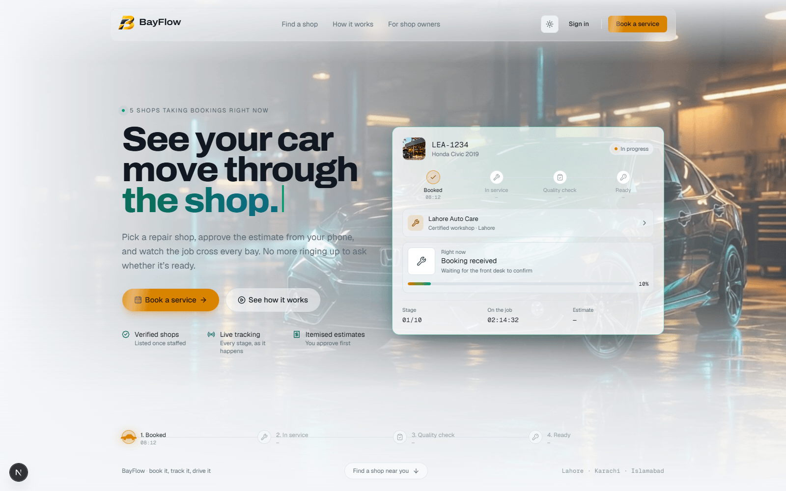

<!-- SEO Meta Tags
Description: BayFlow is a multi-tenant auto repair shop management platform — a customer booking portal, a role-based shop POS and a backend booking state machine, built for LoopVerse 3.0.
Keywords: auto repair shop management, multi-tenant SaaS, Next.js 16, booking state machine, role-based access control, Prisma, PostgreSQL, Auth.js, hackathon project, WebRTC calling, AI front desk
author: Muhammad Zohaib Khan
canonical: https://github.com/ZohaibCodez/bayflow-auto-repair-shop-management
-->

<!-- Open Graph / Facebook
og:type: website
og:url: https://github.com/ZohaibCodez/bayflow-auto-repair-shop-management
og:title: BayFlow — see your car move through the shop
og:description: A multi-tenant auto repair shop platform: a public booking portal, a role-based POS with an explicit 21-action state machine, tenant-isolated multi-shop ownership, and a bonus in-app calling + AI Front Desk track.
og:image: docs/screenshots/landing-hero.png
og:image:alt: BayFlow landing page — a car moving through a lit service bay, with a live job card tracking its stage
og:site_name: BayFlow
og:locale: en_US
-->

<!-- Twitter Card
twitter:card: summary_large_image
twitter:url: https://github.com/ZohaibCodez/bayflow-auto-repair-shop-management
twitter:title: BayFlow — see your car move through the shop
twitter:description: Multi-tenant auto repair shop platform — booking portal, role-based POS, explicit state machine, WebRTC calling + AI Front Desk. Built for LoopVerse 3.0.
twitter:image: docs/screenshots/landing-hero.png
-->

<!-- GitHub Metadata
topics: nextjs, typescript, prisma, postgresql, multi-tenant, state-machine, rbac, webrtc, hackathon, saas
languages: TypeScript, Prisma Schema, CSS
-->

<div align="center">

<picture>
  <source media="(prefers-color-scheme: dark)" srcset="public/brand/logo-dark.png" />
  <source media="(prefers-color-scheme: light)" srcset="public/brand/logo-light.png" />
  
</picture>

# BayFlow

### See your car move through the shop.

**A multi-tenant auto repair shop management platform** — customer booking portal, role-based shop POS, and a backend booking **state machine** that enforces who can move a job where.

Built for **LoopVerse 3.0 — Web Dev (Virtual)**

<p>
  
  
  
  
  
  
  
</p>
<p>
  
  
  
  <a href="LICENSE"></a>
  
</p>

[**Demo accounts**](#-demo-accounts) · [**Judge walkthrough**](#-a-3-minute-judge-walkthrough) · [**Architecture**](#️-architecture) · [**API reference**](#-rest-api) · [**Tests**](#-tests)

</div>

---

<div align="center">

</div>

---

## 📋 Table of contents

- [What it does](#-what-it-does)
- [Why this, not a form builder](#-why-this-not-a-form-builder)
- [Screenshots](#-screenshots)
- [Tech stack](#-tech-stack)
- [Quick start](#-quick-start)
- [Demo accounts](#-demo-accounts)
- [A 3-minute judge walkthrough](#-a-3-minute-judge-walkthrough)
- [Architecture](#️-architecture)
- [REST API](#-rest-api)
- [Tests](#-tests)
- [Deployment](#-deployment-vercel--neon)
- [Judging criteria coverage](#-judging-criteria-coverage)
- [Project docs](#-project-docs)
- [License](#-license)

---

## 🎯 What it does

Most independent garages still run on paper job cards, WhatsApp chats and phone calls — every hand-off between customer, front desk, technician, parts counter and quality check is a place information gets lost. BayFlow replaces that with one platform, three surfaces, one backend:

- **Customers** find a shop (search + city filter), book in a 4-step wizard that only offers genuinely free slots, then follow the car through every stage, approve or decline an itemised estimate, and confirm pick-up.
- **Shop staff** — Service Advisor, Technician, Parts Person, QC Inspector — each get a dashboard that shows only their own work, and can only perform their own steps.
- **Owners** run several shops, each with its own team, services, slots and inventory, and switch between them in one click.
- **Every step is accountable** — each status change is written to an audit log (who, role, when, from → to, note), and the people involved are notified in-app.
- **Bonus — in-app calling + AI Front Desk** — customer and service advisor call each other from the booking page (browser WebRTC, no phone numbers shared). If no advisor answers within 20 seconds, an AI voice agent takes the call, answers only from the caller's own bookings, and leaves the advisors a summary + task.
- **Extras** — printable invoice / job sheet, vehicle service history by plate, owner analytics (revenue, turnaround, QC pass rate), light & dark themes, mobile-responsive throughout.

### ✨ Why this, not a form builder

<table>
<tr>
<td width="50%" valign="top">

**🔒 Multi-tenancy that's actually enforced**
- Every shop-owned row is fetched `WHERE id AND shopId`
- A staff token for Shop A gets **403/404** on Shop B's data — guessing IDs doesn't work
- Technicians see only their assigned jobs; QC shares one queue with a first-to-pick lock

**⚙️ One real state machine, not a status enum**
- 21 actions, each with its allowed source statuses, target status, and exactly who may fire it
- Invalid transitions are rejected before they ever touch the database

</td>
<td width="50%" valign="top">

**🧾 Every number is backed by a transaction**
- Slot capacity: atomic claim, never overbooked under concurrent requests
- QC claim and the status write itself: compare-and-set, so two actors racing get one winner and a `409`, not a silent overwrite
- Parts reservation → allocation → release, logged to an append-only stock ledger

**🤖 A bonus track that respects the core**
- WebRTC calling needs no media server (signalling only)
- The AI Front Desk is tool-scoped to the caller's own bookings — it cannot see, let alone touch, anyone else's data

</td>
</tr>
</table>

---

## 🎬 Screenshots

<div align="center">

### The POS — a role-based command centre, not a wall of tabs



*The owner's overview: a headline that states what needs them, a queue ranked by how long each job has waited, every live car on the seven-phase pipeline, and the shop's numbers as one instrument band.*

<br />

<table>
<tr>
<td width="50%">

<p align="center"><sub>Customer dashboard — pending-action banner, live progress rail, real shop photography</sub></p>
</td>
<td width="50%">

<p align="center"><sub>Booking wizard — services, live slot availability, a sticky review summary</sub></p>
</td>
</tr>
<tr>
<td width="50%">

<p align="center"><sub>Sign-in — one-click demo roles, built for judges to explore fast</sub></p>
</td>
<td width="50%">

<p align="center"><sub>Inventory & procurement — required-vs-available, reorder flags, a stock ledger</sub></p>
</td>
</tr>
</table>

<details>
<summary><b>More screens</b> — QC queue, shop directory, light mode</summary>
<br />


<p align="center"><sub>Public shop directory — search, city filter, real cover photography per shop</sub></p>


<p align="center"><sub>QC queue — any inspector can pick a job; first to pick locks it</sub></p>


<p align="center"><sub>Light mode — a second, contrast-checked palette, not an inverted filter</sub></p>

</details>

</div>

---

## 🛠️ Tech stack

| Layer | Technology |
|---|---|
| **Framework** | [Next.js 16](https://nextjs.org) (App Router, Server Actions, Route Handlers) · [React 19](https://react.dev) |
| **Language** | TypeScript, strict mode |
| **Database** | PostgreSQL on [Neon](https://neon.tech) · [Prisma 6](https://prisma.io) |
| **Auth** | [Auth.js v5](https://authjs.dev) — credentials + JWT sessions |
| **Styling** | Tailwind CSS 4 · shadcn/ui (Base UI) · [Motion](https://motion.dev) for layout animation |
| **Validation** | Zod 4 at every API boundary |
| **Calling / AI** | Browser WebRTC (no media server) · Groq / Claude tool-calling for the AI Front Desk |
| **Testing** | Vitest (unit) · Playwright/Chrome (E2E — lifecycle, security, owner, public, bonus track) |
| **Deployment** | Vercel |

Full rationale for every choice: **[STACK.md](STACK.md)**.

<details>
<summary><b>📦 Why each one, briefly</b></summary>

- **Next.js App Router** — one deploy serves the public portal, customer dashboard and POS; Server Actions keep most writes out of a separate API layer entirely.
- **Prisma + Postgres** — transactions and `WHERE` clauses are how tenant isolation and the state machine's compare-and-set updates are actually enforced; an ORM that makes both easy to read matters here more than raw speed.
- **Auth.js v5** — session-based auth with role data attached per shop membership, not a global role.
- **Zod** — every route handler parses its input before touching the database; a malformed body is a `422`, not a stack trace.
- **Motion** — the only animation library used, and only where a layout actually needs to persist identity across a DOM move (a job card travelling bays on the floor board).

</details>

---

## 🚀 Quick start

### Prerequisites

| Tool | Version |
|---|---|
| Node.js | **22 LTS** (20.9+ works) |
| pnpm | **10+** (`npm i -g pnpm`) |
| PostgreSQL | **15+** — a free [Neon](https://neon.tech) database, or a local Postgres |
| Google Chrome | any recent version (only for the E2E tests) |

### Installation

1️⃣ **Clone and install**

```bash
git clone https://github.com/ZohaibCodez/bayflow-auto-repair-shop-management.git
cd bayflow-auto-repair-shop-management
pnpm install          # also runs `prisma generate`
```

2️⃣ **Configure environment**

```bash
cp .env.example .env
```

| Variable | What it is |
|---|---|
| `DATABASE_URL` | Pooled Postgres connection string (Neon: the `-pooler` host). Used at runtime. |
| `DIRECT_URL` | Direct (non-pooled) connection string. Used by migrations and the seed. Same as `DATABASE_URL` for a local Postgres. |
| `AUTH_SECRET` | Signs session tokens. Generate with `npx auth secret`. |
| `AUTH_SESSION_DAYS` | Sign-in lifetime in days (default 7). |
| `NEXT_PUBLIC_APP_URL` | Base URL of the app. |
| `GROQ_API_KEY` | *Optional.* Runs the AI Front Desk on Groq (`GROQ_MODEL`, default `openai/gpt-oss-120b`). Get one at console.groq.com. |
| `ANTHROPIC_API_KEY` | *Optional.* Runs the AI Front Desk on Claude instead, when `GROQ_API_KEY` is blank. With neither key a rule-based agent answers, so the demo still works. |
| `NEXT_PUBLIC_TURN_*` | *Optional.* A TURN relay for calls between strict networks (mobile data, offices). Calls work without it on most networks. |
| everything else | Optional — leave blank. Each variable is commented in `.env.example`. |

3️⃣ **Database**

```bash
pnpm db:deploy        # apply migrations (use `pnpm db:migrate` while developing the schema)
pnpm db:seed          # demo shops, teams, services, inventory and demo bookings
```

`pnpm db:seed` is **idempotent and doubles as "reset demo"**: it upserts the demo shops/users/services/inventory and re-creates the demo bookings of the seeded shops. Shops you create yourself are never touched.

<details>
<summary><b>Resetting to a pristine demo</b></summary>
<br />

Testing — manual or Playwright — leaves residue behind: extra shops, extra accounts, half-finished bookings. To get back to exactly the five seeded shops:

```bash
pnpm db:clean         # dry run: prints what would be deleted, deletes nothing
pnpm db:demo          # clean + seed, the one-command reset
```

`db:demo` deletes every shop that is not one of the five canonical `shop_*` ids and every account that is not a seeded demo account, then reseeds. Run it before any judging or demo session so the public directory shows five shops and nothing else.

</details>

4️⃣ **Run**

```bash
pnpm dev              # http://localhost:3000
```

Windows: double-click **`run.bat`** — it installs, creates `.env`, generates the client, optionally migrates + seeds, and starts the dev server.

5️⃣ **Test**

```bash
pnpm test             # unit tests (Vitest): state machine + slot/time logic
pnpm db:seed          # fresh demo data for the E2E run
pnpm test:e2e         # end-to-end (Playwright, uses your installed Chrome)
pnpm test:e2e:ui      # same, in Playwright's UI mode
E2E_BASE_URL=https://<live-url> pnpm test:e2e   # run the suite against a deployment
```

Other scripts: `pnpm lint`, `pnpm typecheck`, `pnpm format`, `pnpm db:studio`.

🎉 **Success!** Navigate to `http://localhost:3000` and sign in with any [demo account](#-demo-accounts) below.

---

## 🔑 Demo accounts

All demo accounts use the password **`password123`**. The login page has one-click buttons to fill each of them.

| Role | Email | Notes |
|---|---|---|
| Owner | `owner@bayflow.test` | Fatima — owns Lahore, Karachi and Islamabad shops (try the shop switcher) |
| Owner #2 | `owner2@bayflow.test` | Hamza — owns Rawalpindi and Faisalabad (can't see Fatima's shops) |
| Service Advisor | `sa.lahore@bayflow.test` | Bilal |
| Technician | `tech.lahore@bayflow.test` | Imran |
| Parts Person | `parts.lahore@bayflow.test` | Usman |
| QC Inspector | `qc.lahore@bayflow.test` | Sara (a second inspector: `qc2.lahore@bayflow.test`) |
| Customer | `customer@bayflow.test` | Ahmed — has an estimate waiting for approval |
| Customer | `sana@bayflow.test`, `ali@bayflow.test` | more demo customers |

Every shop has a full team: `sa.<shop>`, `tech.<shop>`, `qc.<shop>`, `parts.<shop>` `@bayflow.test`, where `<shop>` is `lahore`, `karachi`, `isb`, `pindi` or `fsd`.

<details>
<summary><b>What's waiting in the demo data (Lahore Auto Care)</b></summary>
<br />

| Booking | Status | Try it as |
|---|---|---|
| Ahmed's 2016 Honda Civic — the brief's worked example | Estimate **awaiting customer** (PKR 16,100, ignition coil out of stock) | Customer → approve → then Advisor, Parts (order coil, receive, allocate), Tech, QC… |
| Sana's Toyota Corolla | **Pending** | Advisor → confirm & assign |
| Ali's Honda City | **Assigned** | Technician → start inspection, build an estimate |
| Sana's Suzuki Swift | **QC pending** | QC → pick, then fail it (issue) or pass it |
| Ali's Kia Sportage | **Ready for pick-up** | Advisor → notify / complete, or Customer → "I've collected my car" |

</details>

---

## 🧭 A 3-minute judge walkthrough

1. **Customer** — open the landing page, pick a shop, book through the wizard (a new email creates the account; a known email + password reuses it).
2. **Advisor** (`sa.lahore`) — the booking is in *New bookings*: confirm and assign Imran in one step.
3. **Technician** (`tech.lahore`) — *To inspect*: start the inspection and add parts (from inventory, out-of-stock is flagged) and labour → submit.
4. **Advisor** — review and adjust a line (counts a revision) → send to customer.
5. **Customer** — the banner says *Estimate awaiting your approval* → decline it once; the advisor revises and resends; approve.
6. **Advisor** — hand to parts. **Parts** (`parts.lahore`) — reserve what's on the shelf, order what's missing, confirm a partial then full delivery, allocate.
7. **Technician** — send to QC. **QC** (`qc.lahore`) — pick the job (locks it), fail it with an issue → it returns to the technician → resubmit → pass.
8. **Advisor** — notify the customer; **Customer** confirms pick-up → **COMPLETED**. The audit log on the job page shows every step.
9. **Isolation** — sign in as `sa.karachi@bayflow.test` and request a Lahore booking: `GET /api/shops/<lahoreShopId>/bookings` → **403**.

### 📞 Bonus: calling and the AI Front Desk (two browsers)

Use two browser windows (or one normal + one private), allow the microphone when asked.

1. **Window A — Customer** (`customer@bayflow.test`): open the Honda Civic booking → **Call the shop in-app**.
2. **Window B — Advisor** (`sa.lahore@bayflow.test`, any POS page): an incoming-call popup rings → **Accept** and talk. Hang up — the call is logged on the booking with its duration. The advisor can also call the customer from the job page (**Call customer in-app**).
3. **The AI path** — call again from window A, and this time let it ring for 20 seconds (or press **Decline** in B). The **AI Front Desk** picks up: speak, or type in the box. Ask *"what's the status of my car?"*, *"how much is the estimate?"* or *"can I move my appointment to Monday?"* — it answers from Ahmed's own booking only (the estimate is PKR 16,100, awaiting approval) and records reschedule / call-back requests. Press **End call**.
4. **Window B** — the bell shows *AI Front Desk: …*; **Calls & AI** in the sidebar lists the follow-up: a task title, the AI's summary, intent, sentiment and the full transcript → **Mark done**. The same page has the shop's call log; the job page shows that booking's calls.

---

## 🏗️ Architecture

```
            ┌──────────────────────── Next.js 16 (one app, one deploy) ────────────────────────┐
 Browser ──►│  Public portal          Customer portal          Shop POS (role dashboards)       │
            │  /  /book/[shop]        /account/…               /pos/[shopId]/…                   │
            │        │                       │                          │                        │
            │        └──── Server Actions ───┴──── Route Handlers (/api/…, JSON) ───┘            │
            │                              │                                                     │
            │   lib/rbac.ts  ── tenant isolation + booking visibility (every request)            │
            │   lib/booking/state-machine.ts ── statuses, transitions, role guards (pure, tested) │
            │   server/services/* ── workflow, bookings, parts, shops (one DB transaction each)   │
            └──────────────────────────────────┬──────────────────────────────────────────────┘
                                               │ Prisma
                                     PostgreSQL (Neon) — shop-scoped rows, audit log, stock ledger
```

<details>
<summary><b>📁 Project structure</b></summary>

```
src/
  app/
    page.tsx                     landing + shop directory
    book/[shopId]/               booking wizard
    account/                     customer dashboard + booking page
    pos/[shopId]/                POS: overview, bookings, job page, qc, inventory,
                                 purchase-orders, team, services, settings,
                                 calls (AI follow-ups + call log)
    pos/new/                     create a shop
    invoice/[bookingId]/         printable invoice / job sheet
    api/                         REST endpoints (see below)
  lib/
    booking/state-machine.ts     ★ single source of truth for the lifecycle
    rbac.ts                      ★ tenant isolation + access rules
    slots.ts, time.ts            slot generation in shop time (Asia/Karachi)
    errors.ts, api.ts            typed errors → consistent HTTP statuses
  server/
    services/                    domain logic (no Next.js imports — reused by the seed)
      transition.ts              ★ the only code that writes Booking.status
      workflow.ts, parts.ts, bookings.ts, shops.ts
      calls.ts                   call signalling (WebRTC offer/answer) + call log
      frontdesk.ts               AI Front Desk: caller-scoped tools, Groq / Claude / rules
    actions/                     server actions (auth → service → refresh)
    queries/                     read models for pages
  components/                    booking/, calls/, pos/, marketing/, ui/ (shadcn), theme/
  proxy.ts                       optimistic login redirect (keeps deep links)
prisma/  schema.prisma · migrations/ · seed.ts
e2e/     Playwright: lifecycle, security, owner, public, frontdesk specs
```

</details>

<details>
<summary><b>🔑 Key design decisions</b></summary>

- **One explicit state machine.** `lib/booking/state-machine.ts` maps 21 actions → allowed source statuses → target status → who may do it (advisor/owner, the *assigned* technician, the *assigned* parts person, any QC / the QC who claimed the job, the booking's customer). `server/services/transition.ts` is the only writer of `Booking.status`: it checks the transition and role, does a **compare-and-set update** (`WHERE status = <current>`), and writes the audit event — all inside the step's transaction.
- **Tenant isolation is server-side.** A `shopId` may come from the URL (the owner's switcher needs it) but is never trusted: every page, action and API route calls `requireShopAccess` / `requireBookingAccess`, and shop-owned rows are always fetched with `where: { id, shopId }`. Another shop's booking is simply *not found*. Technicians only see bookings assigned to them.
- **Race-safe by construction.** Slot capacity: an atomic `INSERT … ON CONFLICT` + conditional `UPDATE … WHERE bookedCount < capacity`. QC claim: compare-and-set on status, so the second inspector gets 409. Stock: conditional decrement `WHERE qtyOnHand >= n` plus an append-only `StockMovement` ledger.
- **Slots come from working hours**, generated in shop time (Asia/Karachi), so a shop always has bookable times however long ago the seed ran; a `Slot` row is created lazily to hold the capacity counter.
- **Parts semantics.** Checking stock *reserves* what's on the shelf for the job; missing parts go on a purchase order; deliveries (full or partial) raise stock and are reserved for the job automatically; allocation hands them to the technician; cancelling before repair *releases* reservations back to stock.
- **Estimates are versioned.** Every advisor edit bumps the revision; after a rejection the next version is a new row, so the rejected estimate (and the customer's reason) is kept. Approval/rejection is time-stamped.
- **Money is whole PKR integers** — no floating-point totals.
- **Calls need no media server.** Voice is browser-to-browser WebRTC; signalling is non-trickle (complete SDP offer/answer stored on the `CallLog` row, both sides poll), so it runs on serverless. The first advisor to answer wins by compare-and-set; an unanswered ring expires to *missed* after 20 s.
- **The AI Front Desk can't overreach.** The caller is identified by their signed-in session, and its only tools (`list_my_bookings`, `get_booking_details`, `request_reschedule`, `request_callback`) are scoped to *that customer's* bookings at *that shop*. It can't approve, cancel or change anything, and is told to answer only from tool results. Speech-to-text and text-to-speech run in the browser. The post-call summary is schema-checked (zod) before it becomes a task; any model error falls back to the rule-based agent mid-call.

</details>

---

## 📚 REST API

All endpoints return JSON. Errors are `{ "error": { "code", "message" } }` with **401** (signed out), **403** (role/tenant), **404** (not found or another tenant's), **409** (invalid transition / conflict), **422** (validation). Authentication is the Auth.js session cookie (sign in through `/login`).

<details open>
<summary><b>View endpoints</b></summary>

| Method & path | Who | Purpose |
|---|---|---|
| `GET /api/shops/:shopId` | public | Shop profile + bookable services |
| `GET /api/shops/:shopId/availability?date=YYYY-MM-DD` | public | Free slots for a shop-local date |
| `POST /api/bookings` | signed-in customer | Book a slot (capacity enforced atomically → 409 when full) |
| `GET /api/bookings` | signed-in customer | Your own bookings |
| `GET /api/shops/:shopId/bookings?status=A,B&q=` | shop staff | Shop bookings (technicians: only their own) |
| `GET /api/shops/:shopId/bookings/:bookingId` | shop staff | Booking detail, estimate, parts, history + the actions *you* may take |
| `POST /api/shops/:shopId/bookings/:bookingId/transitions` | per action | `{ "action": "confirm" \| "assignTechnician" \| … \| "cancel", … }` |
| `GET /api/shops/:shopId/team` | owner, advisor | Team members |
| `GET /api/shops/:shopId/inventory` | owner, parts | Stock levels |
| `GET/POST /api/notifications` | signed in | Bell feed / mark read |
| `POST /api/calls` | booking's customer, shop advisor | `{ bookingId, offer }` — start a call about a booking |
| `GET /api/calls/incoming` | signed in | Calls ringing for you (popup) |
| `GET /api/calls/:callId` | call parties | Call state (+ the answer SDP for the caller) |
| `POST /api/calls/:callId/answer` · `/decline` · `/end` · `/missed` | call parties | Call lifecycle (first answer wins → 409 for the rest) |
| `POST /api/calls/:callId/ai` | the calling customer | `{ text? }` — AI Front Desk greeting, then one turn per call |
| `POST /api/calls/:callId/ai/end` | the calling customer | Hang up on the AI → summary + advisor task |
| `POST /api/shops/:shopId/ai-tasks/:taskId/done` | owner, advisor | Mark an AI follow-up done |

</details>

---

## 🧪 Tests

| Suite | What it proves |
|---|---|
| `src/lib/booking/state-machine.test.ts` (Vitest) | every happy-path transition; reject/revise, in-stock skip, QC fail loop, cancellation window; no role can do another's action; invalid transitions rejected |
| `src/lib/slots.test.ts` (Vitest) | slot generation per working hours, Saturday hours / Sunday closed, forged times rejected, PKT day rollover |
| `e2e/lifecycle.spec.ts` | the brief's worked example through the real UI, each role in its own browser — new customer → … → estimate **rejected** → revised → approved → parts ordered, **partial** then full delivery → allocated → **QC fails** → rework → passes → collected → **COMPLETED**, with the exact audit trail and stock levels asserted |
| `e2e/security.spec.ts` | 401s; **Shop-A staff → 403/404 on Shop-B**; owner isolation; technician sees only assigned jobs; customers can't touch others' bookings; role guards on transitions; 422 validation; cross-tenant assignment blocked; **concurrent slot booking (409 on overflow)**; **concurrent QC claim (first wins, 409)**; cancel returns reserved stock |
| `e2e/owner.spec.ts` | owner signup → shop → team → service → second shop → switcher; staff scoping; deactivation revokes access |
| `e2e/public.spec.ts` | directory search/filter, wizard availability, theme toggle persistence, no horizontal scroll at 375px, login redirects, per-role page access, notification bell |
| `e2e/frontdesk.spec.ts` | bonus track: an unanswered customer call is **missed**; another shop's advisor can't answer it; the **AI Front Desk** answers the estimate from the caller's own booking; another customer is **403**; hanging up creates a summary task; the advisor sees summary + transcript, **marks it done**, and finds the call on the booking's log; a technician can't open the inbox |

```
Vitest   48/48 passing   (state machine, queue ranking, slot generation)
Playwright   lifecycle · security · owner · public · frontdesk — all green on Chrome
```

---

## 🌐 Deployment (Vercel + Neon)

1. Create a Neon project (pick a region near your users — e.g. Singapore for Pakistan) and copy the **pooled** and **direct** connection strings.
2. Import the GitHub repo into Vercel. Set `DATABASE_URL`, `DIRECT_URL`, `AUTH_SECRET`, `AUTH_SESSION_DAYS`, `NEXT_PUBLIC_APP_URL` (and `GROQ_API_KEY` for the AI Front Desk). Set the **Function Region** to the same region as the database (every workflow step is a transaction — keep the round trips short).
3. Build command: `prisma migrate deploy && next build` (or run `pnpm db:deploy` once from your machine).
4. Seed once from your machine against the production database: `pnpm db:seed`.
5. Smoke-test: `E2E_BASE_URL=https://<your-app>.vercel.app pnpm test:e2e`.

> **Live URL:** deployment in progress — this line is updated the moment the first production deploy goes out. The app runs end-to-end locally today; see [Quick start](#-quick-start).

---

## ✅ Judging criteria coverage

Mapped against the brief's own weighting, so a reviewer can jump straight to the evidence.

| Criterion | Weight | Where to look |
|---|---:|---|
| Core flow completeness | 35% | [Judge walkthrough](#-a-3-minute-judge-walkthrough) · `e2e/lifecycle.spec.ts` runs the whole thing, including the QC-fail loop and the estimate-reject path |
| Architecture & code quality | 20% | [Key design decisions](#-key-design-decisions) · `lib/booking/state-machine.ts` · `server/services/transition.ts` · strict TypeScript, Zod at every boundary |
| Product & UX | 15% | [Screenshots](#-screenshots) · role dashboards that show only relevant work · light/dark · mobile-responsive |
| Deployment & docs | 10% | This README, `.env.example`, `pnpm db:demo` for a one-command reset to a judge-ready state |
| Multi-tenancy & security | 10% | `e2e/security.spec.ts` · `lib/rbac.ts` · every shop-owned row scoped `WHERE id AND shopId` |
| Bonus (calling / AI Front Desk) | 10% | [Bonus walkthrough](#-bonus-calling-and-the-ai-front-desk-two-browsers) · `e2e/frontdesk.spec.ts` |

---

## 📄 Project docs

- **[STACK.md](STACK.md)** — the locked stack and the hard rules.
- **[PLAN.md](PLAN.md)** — data model, the state machine table, phases.
- **[TRACKER.md](TRACKER.md)** — task board and activity log.
- **[docs/QA-MANUAL.md](docs/QA-MANUAL.md)** — a 176-step manual test pass mapped to the brief, section by section.
- `docs/Web Dev - Virtual.pdf` — the hackathon brief.

## 📄 License

MIT — see **[LICENSE](LICENSE)**.

---

<div align="center">

**BayFlow** · built for **LoopVerse 3.0 — Web Dev (Virtual)**

<sub>Core flow, tenant isolation and the bonus track are tested end-to-end. See [TRACKER.md](TRACKER.md) for what's left before submission.</sub>

</div>
